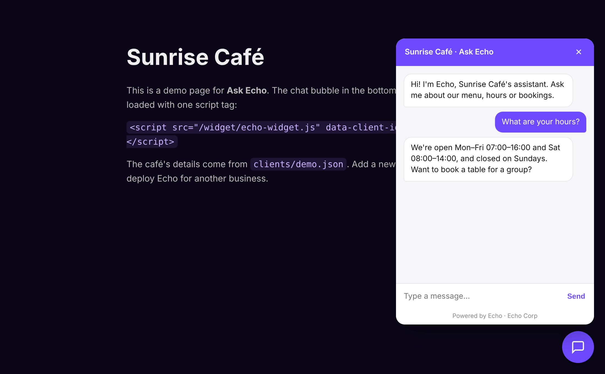

# Ask Echo

**A drop-in, Claude-powered AI assistant for any website: one script tag, per-client config, API key kept on the server.**

Ask Echo is the website assistant I built for [Echo Corp](https://echocorp.co.za). Versions of it run on three client sites, handling enquiries for a youth football academy and a renovation company, and product recommendations for a fragrance store. This repo is a clean, open-source version of the same architecture with a demo café as the example client.



## What it does

- **One-line install.** Add a `<script>` tag with a `data-client-id` and the chat bubble appears.
- **One server, many clients.** Each business is a JSON file in `clients/` with its name, colours, greeting, suggested questions, system prompt and business facts.
- **Secure by default.** The Anthropic API key never reaches the browser. The server checks each request's origin against the client's allowlist and rate-limits by IP.
- **Grounded answers.** The model gets the business facts and is told not to invent prices or details it wasn't given.
- **Safe rendering.** Replies are inserted as text, never HTML, so model output can't inject script into the host page.
- **Lightweight.** The widget is plain JavaScript with no framework and no build step, about 6 KB.

## How it works

```
Visitor's browser                      Ask Echo server                    Anthropic API
┌───────────────────┐  POST /api/chat  ┌──────────────────────┐  /v1/messages ┌────────────┐
│ echo-widget.js    │ ───────────────▶ │ load clients/<id>.json│ ────────────▶ │  Claude    │
│ (client: "demo")  │ ◀─────────────── │ CORS + rate limit     │ ◀──────────── │            │
└───────────────────┘   { reply }      │ build system prompt   │               └────────────┘
                                       └──────────────────────┘
```

## Built with

Node.js · Express · Anthropic Messages API · vanilla JavaScript

## Run it locally

```bash
git clone https://github.com/<your-username>/ask-echo.git
cd ask-echo
npm install
cp .env.example .env        # then paste your Anthropic API key into .env
npm start
```

Open **http://localhost:8787** and click the chat bubble.

## Add a new client

1. Copy `clients/demo.json` to `clients/acme.json` and edit the details.
2. Add the client's website to `allowedOrigins`, for example `"https://acme.co.za"`.
3. Put this on their site:

```html
<script src="https://YOUR-SERVER/widget/echo-widget.js"
        data-client-id="acme"
        data-api="https://YOUR-SERVER" defer></script>
```

## Project structure

```
server/index.js        API proxy: config loading, CORS, rate limit, Claude call
widget/echo-widget.js  Embeddable chat widget
clients/*.json         One config file per business
demo/index.html        Demo page
```

## Roadmap

- Stream replies token by token
- Hand-off to WhatsApp or email when the visitor wants a human
- Log questions to Supabase so clients can see what customers ask most

## License

MIT, © Riyasat Rehman (Echo Corp)
